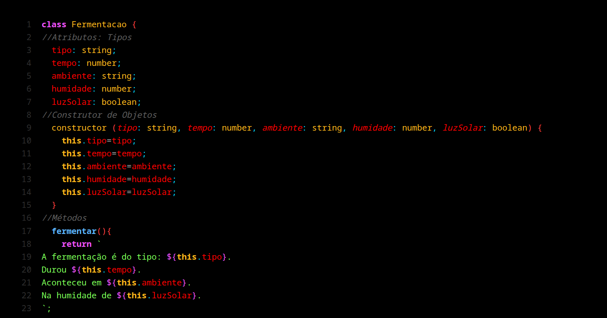
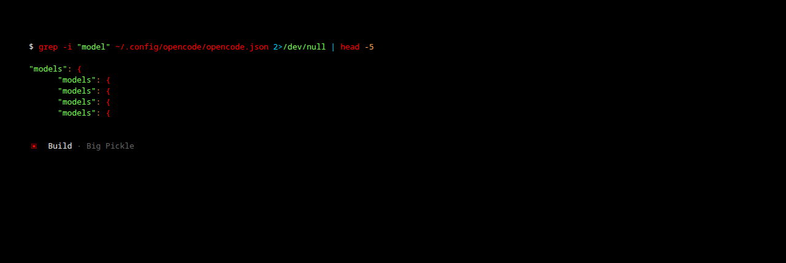

# VOSTOK

**Soviet-grade neon theme for Neovim + OpenCode.** Pure OLED black, super-saturated syntax, Tron-blue delimiters. Built for scannability — including ADHD brains.

Based on [Scoria](https://github.com/Zyplos/scoria) by Zyplos (OLED black + red VSCode theme), pushed to full neon saturation with a Tron-blue punctuation family.

## Screenshots

Neovim (TypeScript):



OpenCode TUI (shell commands with tree-sitter highlight):



## Palette

| Role | Hex | Notes |
|---|---|---|
| Background | `#000000` | Absolute black, everywhere |
| Variable / property | `#ff2a00` | Scarlet — exact inverse of Tron `#00d5ff` |
| Keyword | `#f352ff` | Neon magenta |
| Type / class | `#ffb81a` | Neon gold |
| String | `#7bff57` | Neon green |
| Function | `#5cb6ff` | Neon blue |
| Operator / regex | `#1aefff` | Neon cyan |
| Number / constant | `#ffa34c` | Tron orange |
| Text / punctuation base | `#a4b0c6` | Readable gray-blue |
| Delimiters `; , . :` | `#00d5ff` | Tron blue |
| UI accent | `#ff3e3e` | Scoria red |
| Cursor (editor) | `#ffd300` | Yellow block |

## Neovim

Standalone colorscheme, zero dependencies. Copy the file:

```sh
mkdir -p ~/.config/nvim/colors
cp nvim/colors/vostok.lua ~/.config/nvim/colors/
```

Then activate (LazyVim example — `lua/plugins/theme.lua`):

```lua
return {
  {
    name = "vostok",
    dir = vim.fn.stdpath("config"),
    lazy = false,
    priority = 1000,
    config = function()
      vim.cmd.colorscheme("vostok")
    end,
  },
}
```

Or plain init.lua: `vim.cmd.colorscheme("vostok")`.

Rainbow brackets (fire ramp, like Scoria) pair well with [rainbow-delimiters.nvim](https://github.com/HiPhish/rainbow-delimiters.nvim):

```lua
{ "HiPhish/rainbow-delimiters.nvim", event = "BufReadPost" }
```

## OpenCode

```sh
mkdir -p ~/.config/opencode/themes
cp opencode/vostok.json ~/.config/opencode/themes/
```

Activate in `~/.config/opencode/tui.json`:

```json
{
  "$schema": "https://opencode.ai/tui.json",
  "theme": "vostok"
}
```

Or switch live with `/theme`.

Bonus: per-mode colors in `~/.config/opencode/opencode.json` — scarlet build, Tron-blue plan:

```json
{
  "agent": {
    "build": { "color": "#ff2a00" },
    "plan": { "color": "#00d5ff" }
  }
}
```

## TUI patch (`opencode/tui-vostok-1.18.30.patch`)

The theme alone doesn't cover behavior. This patch (against
[opencode](https://github.com/anomalyco/opencode) `v1.18.30`) adds:

- **RSVP thought player** — streaming reasoning rendered word-by-word with
  ORP pivot (450 WPM, no-drop queue, post-done tail drain, canonical
  Spritz styling), in place of the collapsed thinking header
- **Agent-colored navigation** — selections and chrome follow the mode color
- **Shell tree-sitter highlight**, always-expanded output, no animations,
  sticky autoscroll off

Apply + rebuild (needs [bun 1.3.14](https://bun.sh), binary reports `1.18.30`):

```sh
git clone --branch v1.18.30 --depth 1 https://github.com/anomalyco/opencode.git
cd opencode
git apply /path/to/tui-vostok-1.18.30.patch
OPENCODE_VERSION=1.18.30 bun run script/build.ts --single --skip-embed-web-ui --skip-install
cp dist/opencode-linux-x64/bin/opencode ~/.opencode/bin/opencode.new
mv ~/.opencode/bin/opencode.new ~/.opencode/bin/opencode
```

## Why these choices

- **Few hues, max separation** — each syntax category owns one hue; color-coding with ≤6 categories reduces cognitive load instead of adding noise.
- **No blue as semantic carrier** — blue-on-black is the worst contrast pair and blue/red saturation discrimination is the weakest link in low-dopamine color vision (see: retinal dopaminergic hypothesis of ADHD).
- **Warm spectrum carries meaning** (red→orange→gold fire ramp as an attention gradient); cool colors reserved for strings and metadata.
- **Structure stays visible** — delimiters and brackets are never dimmed into the background.

## Credits

- Base theme: [Scoria](https://github.com/Zyplos/scoria) by [Zyplos](https://github.com/Zyplos) (MIT) — syntax soul is One Dark, UI shell is OLED black + `#ff3e3e`.
- Neon adaptation, OpenCode port, and mode colors: [Data338](https://github.com/Data338).

## License

MIT — see [LICENSE](./LICENSE).
